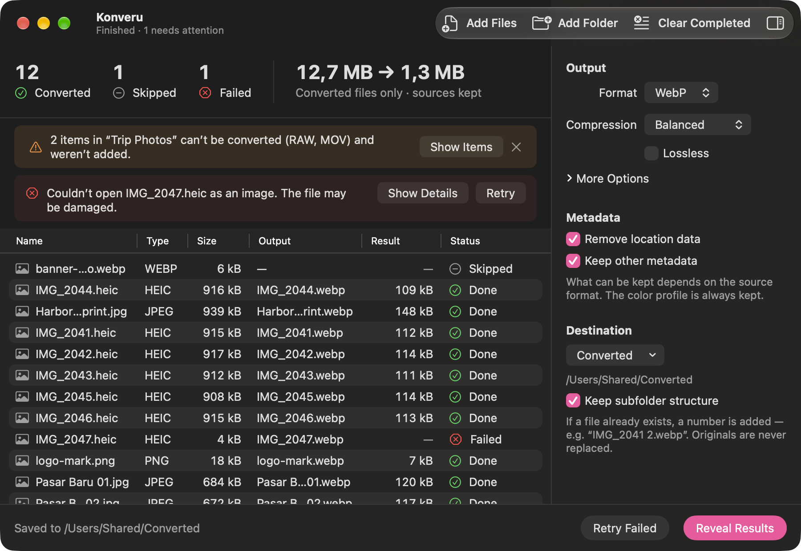

<p align="center">
  
</p>

<p align="center">
  
  
  
</p>

<h1 align="center">Konveru</h1>

<p align="center">
  A fast, private image converter for macOS, built entirely with SwiftUI.
</p>

<p align="center">
  Convert batches of JPEG, PNG, and HEIC images to WebP.<br>
  No uploads, no Homebrew, and no overwritten originals.
</p>



## Why Konveru?

Konveru keeps batch conversion simple and local. Drop in files or folders, choose the output quality and metadata options, then convert everything without sending images to a server or installing a separate encoder.

- **Native macOS app:** SwiftUI interface with Light and Dark Mode support.
- **Self-contained WebP encoder:** libwebp is linked directly into the app.
- **Batch conversion:** Add individual images, whole folders, or nested folder structures.
- **Lossy and lossless output:** Use presets or choose an exact quality value.
- **Privacy controls:** Remove location data, preserve other metadata, or discard metadata entirely.
- **Color accurate:** Non-sRGB profiles such as Display P3 are preserved.
- **Safe file handling:** Originals are untouched and existing outputs are never replaced.
- **Built for macOS:** Finder reveal actions, keyboard shortcuts, menu commands, drag and drop, and VoiceOver labels.

## Requirements

- macOS 26 or later
- Apple silicon Mac
- Xcode 27 or later to build from source

The bundled libwebp archives are arm64-only and target macOS 26. Building and running Konveru does not require Homebrew.

## Building

Clone the repository, then open `Konveru.xcodeproj` in Xcode.

1. Select the **Konveru** scheme.
2. Choose **My Mac** as the run destination.
3. Press <kbd>⌘R</kbd> to build and run.

Run the test suite with <kbd>⌘U</kbd>, or from the command line:

```sh
xcodebuild -project Konveru.xcodeproj -scheme Konveru test
```

The tests exercise the real encoder using temporary JPEG, PNG, and HEIC fixtures. They cover orientation, alpha, lossless output, metadata, color profiles, filename collisions, failure handling, and cancellation.

## Creating a DMG without an Apple Developer membership

Run the packaging script from the repository root:

```sh
./scripts/package-dmg.sh
```

The script creates an Apple silicon Release build, applies an ad-hoc signature, verifies the app bundle, and writes `Konveru-<version>-arm64.dmg` to `dist/`. The disk image contains `Konveru.app` and a shortcut to the Applications folder.

This distribution is **not notarized** because notarization requires an Apple Developer Program membership and a Developer ID certificate. On a different Mac, Gatekeeper may block the first launch. The recipient can Control-click `Konveru.app`, choose **Open**, and confirm the prompt. Do not ask recipients to disable Gatekeeper globally.

Before sharing a release, test the DMG on another Apple silicon Mac and compare its SHA-256 checksum with the value printed by the script.

## Using Konveru

1. Drag images or folders into the window, or use **Add Files** and **Add Folder**.
2. Choose lossy or lossless compression and adjust the quality if needed.
3. Select which metadata to keep and where converted files should be saved.
4. Click **Convert** or press <kbd>⌘↩</kbd>.
5. Use **Reveal Results** to show the completed files in Finder.

By default, Konveru writes to a `Konveru` folder beside the source files. When a batch contains sources from different folders, the app asks for a destination.

## File safety

Konveru is deliberately conservative with files:

- Output is first written to a hidden temporary file.
- An exclusive rename moves it into place without replacing anything already on disk.
- Name collisions become `image 2.webp`, `image 3.webp`, and so on.
- Every completed WebP is decoded again and checked against the expected dimensions.
- If verification fails, the invalid output is removed and the item is reported as failed.
- Canceling removes the current temporary output while keeping files that already finished.

## Metadata and color

EXIF orientation is applied to the pixels before encoding, so rotated photos remain correctly oriented. When metadata is enabled, Konveru can remove GPS and common IPTC location fields while retaining other EXIF and XMP data. Embedded non-sRGB color profiles, including Display P3, are carried into the WebP output.

## How it works

Konveru uses ImageIO to decode source images, Accelerate/vImage to prepare RGBA pixels, and the statically linked libwebp encoder to create WebP output. libwebpmux adds ICC, EXIF, and XMP chunks when requested.

| Area | Responsibility |
| --- | --- |
| `Konveru/Conversion` | Decoding, WebP encoding, metadata, naming, atomic writes, and verification |
| `Konveru/Queue` | File discovery, batch state, destinations, settings, retries, and cancellation |
| `Konveru/Views` | SwiftUI interface for the drop zone, queue, options, progress, and results |
| `Konveru/App` | App entry point, focused menu commands, and the debug harness |
| `KonveruTests` | End-to-end encoder and queue behavior tests using Swift Testing |

The vendored libwebp 1.6.0 headers and static libraries live in `Vendor/libwebp`. Its BSD license is included at `Vendor/libwebp/COPYING`.

## Supported formats

| Input | Output |
| --- | --- |
| JPEG | WebP |
| PNG | WebP |
| HEIC / HEIF | WebP |
| WebP | WebP re-encode, when explicitly enabled |

WebP dimensions are limited to 16,383 pixels per side by the format and encoder.

## Project status

Konveru currently converts one image at a time. This keeps progress reporting and cancellation predictable while still moving encoding work off the main actor. The app is not sandboxed because its default workflow writes a new folder beside selected source files.

## Acknowledgments

Konveru uses [libwebp](https://chromium.googlesource.com/webm/libwebp/) for WebP encoding and muxing.
